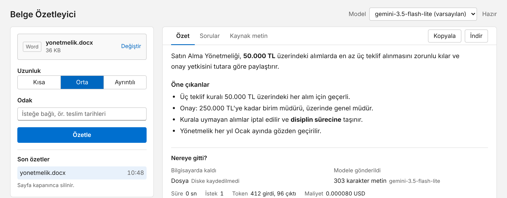
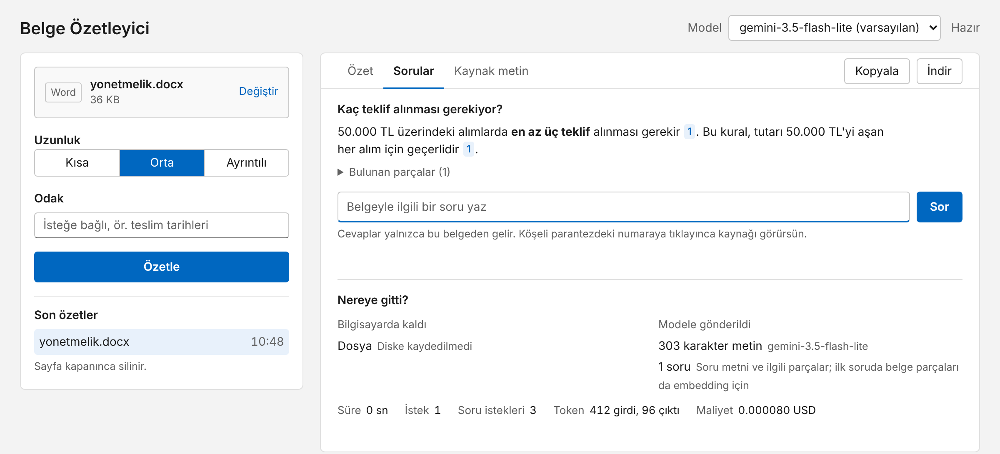
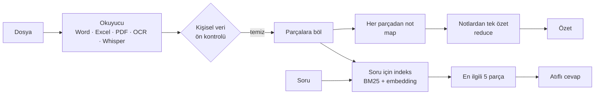

# Belge Özetleyici

[](https://github.com/KASIMEMRE/ozetleyici/actions/workflows/test.yml)


Word, Excel, PowerPoint, PDF, görsel, ses ve video dosyalarını Türkçe özetleyen, sonra belge hakkında
sorulan soruları **kaynak göstererek** cevaplayan bir araç. Tarayıcıda çalışan bir arayüzü ve bir komut
satırı aracı var. Gemini, Claude, OpenAI veya bilgisayarında çalışan Ollama ile kullanılabilir.



## Neler yapar

- **Her türden belgeyi okur:** Word, Excel, PowerPoint, PDF, CSV, taranmış belgeler (OCR), ses ve video kayıtları.
- **Uzun belgeleri parçalayarak özetler:** önce her parçadan not çıkarır, sonra notları tek özette birleştirir.
- **Belgeye soru sorabilirsin:** cevap yalnızca belgeden gelir; her bilginin yanındaki `[1]` numarasına
  tıklayınca dayandığı yer vurgulanır. Belgede cevap yoksa bunu söyler, uydurmaz.
- **Ne kadar harcayacağını baştan söyler:** belge başına istek sınırı vardır; sınır aşılacaksa hiçbir istek
  gönderilmeden onay ister.
- **Neyin dışarı çıktığını gösterir:** "Nereye gitti?" bölümü, neyin bilgisayarda kaldığını ve modele kaç
  karakter gönderildiğini gösterir. Ses yazıya dökme ve OCR istenirse tamamen yerelde yapılır.
- **Model seçebilirsin:** anahtarının erişebildiği modeller listelenir.



## Hızlı başlangıç (Windows, PowerShell)

Python 3.10 veya üstü gerekir (`python --version`).

```powershell
git clone https://github.com/KASIMEMRE/ozetleyici.git
cd ozetleyici

python -m venv .venv
.\.venv\Scripts\Activate.ps1
pip install -r requirements.txt

copy .env.example .env
notepad .env                          # API anahtarını SADECE bu dosyaya yaz
git config core.hooksPath .githooks   # commit'lere anahtar girmesini engelleyen kanca

python -m ozetleyici.web              # tarayıcıda http://127.0.0.1:8765 açılır
```

Gemini için ücretsiz anahtarı [Google AI Studio](https://aistudio.google.com/apikey)'dan alabilirsin.

<details>
<summary>Kurulumda sorun çıkarsa / macOS ve Linux</summary>

- `Activate.ps1` "running scripts is disabled" hatası verirse bir kez şunu çalıştır:
  `Set-ExecutionPolicy -Scope CurrentUser RemoteSigned`
- macOS/Linux'ta etkinleştirme `source .venv/bin/activate`, kopyalama `cp .env.example .env`.
- Komutları proje klasöründe çalıştır; `No module named ozetleyici` hatası genelde yanlış klasörde olunduğunu gösterir.

</details>

<details>
<summary>İsteğe bağlı: taranmış belgeler için Tesseract</summary>

1. [UB Mannheim Tesseract](https://github.com/UB-Mannheim/tesseract/wiki) sayfasından Windows kurucusunu indir.
2. Kurulumda **Additional language data** altından **Turkish**'i işaretle.
3. Varsayılan yere (`C:\Program Files\Tesseract-OCR`) kurduysan başka ayar gerekmez; başka yere kurduysan
   `.env` dosyasına `TESSERACT_YOLU=` ile `tesseract.exe`'nin tam yolunu yaz.

Tesseract kurulu değilse arayüzdeki "Model ile okuma" seçeneğini veya `--ocr gemini`'yi kullanabilirsin
(bu durumda görüntü sağlayıcıya gider).

</details>

<details>
<summary>Ses ve video için konuşma tanıma modeli</summary>

`requirements.txt` ile [faster-whisper](https://github.com/SYSTRAN/faster-whisper) kurulur. Model ilk ses
dosyasında bir kez indirilir (`small` ≈ 500 MB), sonra internetsiz çalışır. İşlemcide çalıştığı için yavaştır:
10 dakikalık bir kayıt birkaç dakika sürebilir. `.env`'de `WHISPER_MODELI=medium` Türkçede daha doğrudur ama
2-3 kat yavaştır.

</details>

## Desteklenen dosyalar

| Tür | Uzantı | Nasıl okunur |
| --- | --- | --- |
| Metin | `.txt` `.md` | UTF-8, olmazsa Windows Türkçe (cp1254) |
| PDF | `.pdf` | Metinli sayfalar doğrudan, taranmış sayfalar OCR ile |
| Word | `.docx` | Başlıklar, paragraflar, tablolar, bağlantılar; gizli biçimli yazı okunmaz |
| PowerPoint | `.pptx` | Slayt metinleri, gruplu şekiller, tablolar, konuşmacı notları |
| Excel | `.xlsx` `.xlsm` | Her sayfadan 100 satır önizleme + **istatistikler Python'da, tüm satırlardan**; gizli sayfalar ve makrolar okunmaz |
| CSV | `.csv` | `;` `,` sekme ayırıcısı otomatik; Türkçe ondalık (1.234,56) anlaşılır |
| Görsel | `.png` `.jpg` | OCR ile |
| Ses | `.mp3` `.wav` `.m4a` `.ogg` `.opus` `.flac` | Yazıya dökülür (yerel Whisper veya model ile), sonra özetlenir |
| Video | `.mp4` `.mov` `.mkv` `.webm` `.avi` | Yalnızca ses kanalı; ekrandaki yazı ve slaytlar okunmaz |

Eski `.doc` `.xls` `.ppt` biçimleri desteklenmez; Office'te "Farklı Kaydet" ile yeni biçime çevir.
Boyut sınırı belgelerde 25 MB (komut satırında 50 MB), ses ve videoda 200 MB ve en fazla 60 dakikadır.

## Kullanım

### Web arayüzü

`python -m ozetleyici.web` tarayıcıda `http://127.0.0.1:8765` adresini açar.

- Dosyayı sayfaya sürükle, **Ctrl + Enter** ile özetle. Yalnızca o dosya türünde anlamı olan ayarlar görünür.
- **Odak** alanına "yaptırımlar ve süreler" gibi bir istek yazarsan özet ona ağırlık verir.
- **Kaynak metin** sekmesi modelin gördüğü metni gösterir; ses ve videoda bu, yazıya dökülmüş konuşmadır.
- Uzun işlerde aşama, geçen süre ve **Durdur** düğmesi görünür.
- Özeti Markdown, düz metin veya JSON olarak indirebilirsin. **Son özetler** yalnızca bellekte tutulur,
  sayfa kapanınca silinir.

Durdurmak için terminalde **Ctrl + C**.

### Belgeye soru sorma

Özet bittikten sonra **Sorular** sekmesine geç ve belgeyle ilgili soru yaz. Cevaptaki `[1]` gibi numaralara
tıklayınca **Kaynak metin** sekmesinde ilgili bölüm sarıyla işaretlenir. İlk soru belgenin uzunluğuna göre
birkaç istek, sonraki her soru 2 istek harcar.

### Komut satırı

```powershell
python -m ozetleyici belge.pdf                         # orta uzunlukta özet → belge.ozet.json
python -m ozetleyici belge.docx -u kisa -o ozet.json   # kısa özet, çıktı yolu seçili
python -m ozetleyici kayit.m4a --odak "kararlar"       # ses kaydını yazıya döküp özetle
python -m ozetleyici --modelleri-listele               # anahtarının erişebildiği modeller
python -m ozetleyici --help                            # tüm seçenekler
```

<details>
<summary>Tüm seçenekler</summary>

| Seçenek | Açıklama |
| --- | --- |
| `-u, --uzunluk` | `kisa`, `orta` (varsayılan), `uzun` |
| `-o, --cikti` | JSON dosyasının yolu |
| `--model` | `.env`'deki modeli bu çalıştırma için değiştirir |
| `--odak` | Özet neye ağırlık versin (ör. `--odak "teslim tarihleri"`) |
| `--modelleri-listele` | Anahtarının erişebildiği özet modellerini listeler |
| `--temperature` (0-2), `--top-p` (0.01-1) | Örnekleme ayarları; verilmezse API'ye gönderilmez |
| `--max-token` | Cevaptaki en fazla token (varsayılan 1024). Düşünen modellerde 4096 önerilir |
| `--akissiz` | Akış (streaming) yerine tek seferde cevap |
| `--ses` | `yerel` (Whisper, varsayılan, ses bilgisayardan çıkmaz) veya `gemini` |
| `--whisper-modeli` | `tiny` `base` `small` `medium` `large-v3` `turbo` |
| `--ocr` | `yerel` (Tesseract, varsayılan), `gemini` veya `kapali` |
| `--istek-siniri` | Bu belge için en fazla API isteği (varsayılan 20) |
| `--yine-de-gonder` | Belgede kişisel veri ipucu olsa bile gönder |
| `-s, --sessiz` | Bilgi mesajlarını gizle |

Çıkış kodları: `0` başarılı, `1` hata, `2` geçersiz argüman, `3` kişisel veri nedeniyle durduruldu,
`4` istek sınırı nedeniyle durduruldu, `130` Ctrl+C.

</details>

<details>
<summary>Çıktı örneği (JSON)</summary>

```json
{
  "kaynak_dosya": "ornek_belge.txt",
  "olusturulma": "2026-11-04T14:13:49+00:00",
  "arac_surumu": "0.6.0",
  "ozet": "Örnek Şirket A.Ş.'nin 1 Ocak 2027 tarihinde yürürlüğe girecek…",
  "model": "gemini-3.5-flash-lite",
  "parca_sayisi": 1,
  "istek_sayisi": 1,
  "girdi_token": 459,
  "cikti_token": 173,
  "maliyet_usd": null,
  "sure_sn": 11.77,
  "kullanilan_modeller": ["gemini-3.5-flash-lite"]
}
```

`maliyet_usd`, yalnızca `.env`'de `LLM_GIRDI_FIYATI` ve `LLM_CIKTI_FIYATI` verilirse hesaplanır.

</details>

## Sağlayıcı seçimi

`.env` dosyasında üç satır sağlayıcıyı belirler. Hepsi aynı (OpenAI uyumlu) arayüzle konuşur:

| Sağlayıcı | `LLM_BASE_URL` | Not |
| --- | --- | --- |
| Google Gemini | `https://generativelanguage.googleapis.com/v1beta/openai/` | Ücretsiz katmanı var; gerçek API ile denenen sağlayıcı |
| Anthropic Claude | `https://api.anthropic.com/v1/` | Embedding sunmaz: `LLM_EMBEDDING_MODELI=yok` |
| OpenAI | `https://api.openai.com/v1` | |
| Ollama (yerel) | `http://localhost:11434/v1` | Anahtar gerekmez, veri bilgisayardan çıkmaz |

Ayrıntılar ve diğer ayarlar (`LLM_EN_FAZLA_ISTEK`, `WHISPER_MODELI`, fiyatlar…) `.env.example` içinde açıklanmıştır.

## Nasıl çalışır



1. **Okuma.** `okuyucular/` paketi dosyayı türüne göre metne çevirir. Excel'de toplam ve ortalama gibi hesaplar
   Python'da yapılır, çünkü LLM'ler sayılarda güvenilir değildir. Ses ve video, ayrı bir süreçte çözülüp yerel
   Whisper ile yazıya dökülür.
2. **Ön kontrol.** `gizlilik.py` metinde T.C. kimlik no, IBAN, e-posta ve telefon arar; bulursa göndermeden durur.
3. **Özet (map-reduce).** Metin ~12.000 karakterden uzunsa paragraf sınırlarından parçalanır; her parçadan
   ayrıntılı not çıkarılır, sonra notlar tek özette birleştirilir.
4. **Soru-cevap (RAG).** `soru.py` belgeyi sayfa ve slayt sınırlarını koruyan ~1.000 karakterlik parçalara böler.
   Soru gelince iki aramayı birleştirir: anlam benzerliği (embedding vektörleri, numpy ile bellekte) ve kelime
   eşleşmesi (BM25, Türkçe ekler için kaba kök). En iyi 5 parça `<alinti>` etiketleriyle modele verilir ve
   modelden her bilgiye kaynak numarası koyması istenir. Embedding yoksa yalnızca kelime eşleşmesiyle devam eder.
5. **Dayanıklı API istemcisi.** `llm.py` 429, 5xx ve bağlantı hatalarında üstel geri çekilmeyle yeniden dener,
   gerekirse yedek modele geçer; kesik, boş veya filtrelenmiş cevabı kabul etmez; akış yarıda koparsa baştan alır.
6. **Web.** `web/` aynı çekirdeği FastAPI ile sunar; sonuç satır satır JSON olayları (NDJSON) olarak tarayıcıya akar.

<details>
<summary>Proje yapısı</summary>

```
ozetleyici/
├── __main__.py        komut satırı
├── ayarlar.py         .env okuma, anahtar gizleme
├── llm.py             API istemcisi: yeniden deneme, akış, istek bütçesi, embedding
├── ozetle.py          map-reduce özet, prompt'lar
├── soru.py            RAG: parçalama, BM25, hibrit arama, atıflı cevap
├── gizlilik.py        kişisel veri ön kontrolü
├── modeller.py        model listesi ve süzme
├── cikti.py           JSON çıktısı
├── okuyucular/        Word, Excel, PowerPoint, PDF, görsel, ses/video
└── web/               FastAPI sunucusu ve arayüz (HTML/CSS/JS, dış kütüphane yok)
tests/                 internetsiz testler (sahte HTTP sunucusuyla)
scripts/gizli_tara.py  commit öncesi anahtar taraması
```

</details>

## Maliyet kontrolü

Uygulama yalnızca **Özetle** veya **Sor**'a basınca istek atar; arka planda hiçbir şey çalışmaz.

| İş | İstek sayısı |
| --- | --- |
| Kısa belge | 1 |
| Uzun belge | parça sayısı + 1 |
| Model ile OCR | taranmış sayfa başına 1 |
| Model ile ses | 5 dakika başına 1 |
| İlk soru | parça sayısı / 100 + 2 |
| Sonraki sorular | 2 |

- **İstek sınırı** (varsayılan 20, `LLM_EN_FAZLA_ISTEK`): gereken istek iş başlamadan hesaplanır; sınırı aşıyorsa
  hiçbir istek gönderilmeden onay istenir. Tahmin yanlış çıksa bile her istekten önce ayrıca sayıldığı için sınır aşılamaz.
- **Sekmeyi kapatınca iş durur:** bir sonraki istek gönderilmez.
- **Kapalı model para harcatmaz:** faturalandırma bağlı değilse ücretsiz katmanda kapalı bir model seçmek isteğin
  reddedilmesiyle sonuçlanır; uygulama bunu söyler ve boşuna yeniden denemez.

Gemini'nin ücretsiz katmanında ücret alınmaz, sınıra gelince istekler reddedilir. Kendi limitlerini
[AI Studio'da](https://aistudio.google.com/rate-limit) görebilirsin. Ücretli katmana geçersen **Spend**
sayfasından harcama tavanı koy.

## Gizlilik ve güvenlik

> **Belgen sağlayıcıya gider.** Gemini'nin ücretsiz katmanında gönderilen içerik model geliştirmede kullanılabilir
> ve insanlar tarafından okunabilir ([Gemini API ek koşulları](https://ai.google.dev/gemini/terms)). Kişisel veya
> gizli belgeler için ücretli katman ya da verinin bilgisayardan çıkmadığı Ollama'yı kullan.

<details>
<summary>API anahtarının korunması</summary>

- Anahtar yalnızca `.env` dosyasında durur; `.env` `.gitignore`'dadır.
- `.githooks` kancası her commit'ten önce `scripts/gizli_tara.py` ile içeriği tarar; anahtar veya `.env` görürse durdurur.
- GitHub Actions her gönderimde aynı taramayı ve testleri Windows ve Linux'ta çalıştırır.
- Hata mesajlarında ve terminal günlüğünde anahtar `***` ile gizlenir. JSON çıktısına anahtar, belgenin tam metni
  veya dosyanın tam yolu yazılmaz; `*.ozet.json` dosyaları da `.gitignore`'dadır.

</details>

<details>
<summary>Web arayüzünün korumaları</summary>

- Yalnızca `127.0.0.1` adresinde dinler; aynı ağdaki başka bilgisayarlar erişemez. Kullanıcı girişi olmadığından
  bu bilinçli bir karar: ağa açılsa başkası senin anahtarınla istek yaptırabilirdi.
- Her açılışta rastgele bir oturum anahtarı üretilir; API onsuz çalışmaz (CSRF'ye karşı). `Host` başlığı denetlenir
  (DNS rebinding'e karşı).
- Sıkı Content-Security-Policy; belgeden veya modelden gelen metin sayfaya HTML olarak değil düz metin olarak yazılır (XSS'e karşı).
- Yüklenen dosya ve soru sorulan belgeler **diske yazılmaz**, yalnızca bellekte tutulur (en fazla 5 belge, 1 saat).

</details>

<details>
<summary>Kötü niyetli dosyalara karşı</summary>

- Dosyanın gerçek türü ilk baytlarından denetlenir; `.pdf` uzantılı bir zip reddedilir.
- Zip bombaları (açıldığında 200 MB'ı aşan Office dosyaları), şüpheli iç yollar ve piksel bombaları (40 milyon
  pikselden büyük görseller) reddedilir. Excel XML'i `defusedxml` ile ayrıştırılır, makrolar asla çalıştırılmaz.
- Görünmez Unicode karakterler, Word'deki gizli yazılar ve Excel'deki gizli sayfalar modele gönderilmez: bunlar
  belgeye okurun göremeyeceği talimat saklamanın yollarıdır.
- Ses/video çözümleme ayrı bir süreçte, süre ve bellek sınırıyla çalışır ve bu süreç API anahtarlarını görmez.

</details>

<details>
<summary>Prompt injection ve kişisel veri</summary>

- Belge `<belge>`, soru-cevaptaki parçalar `<alinti>` etiketleri arasında gönderilir ve modele içlerindeki talimatları
  uygulamaması söylenir. Bu ilk savunma hattıdır, tam koruma değildir.
- Kişisel veri ön kontrolü kabadır: isim, adres ve plaka gibi verileri yakalamaz, maskeleme yapmaz.
- Model ile OCR ve model ile seste görüntü/ses kontrolden **önce** sağlayıcıya gider (metni ancak okuduktan sonra
  kontrol edebiliriz). Bu yüzden varsayılanlar yerel Tesseract ve yerel Whisper'dır.

</details>

## Testler

```powershell
pip install -r requirements-dev.txt
python -m pytest
```

200'den fazla test internet ve API anahtarı olmadan çalışır; LLM çağrıları sahte bir HTTP sunucusuyla sınanır.
Gerçek sağlayıcıyla tek bir deneme (küçük bir maliyeti olabilir):

```powershell
$env:OZETLEYICI_GERCEK_TEST=1; python -m pytest -m gercek_api -k saglayici
```

<details>
<summary>Gerçek Whisper modeliyle Türkçe deneme</summary>

Ses Kaydedicisi ile "Bugünkü toplantıda bütçe onaylandı ve proje teslim tarihi mart ayına ertelendi." cümlesini kaydet:

```powershell
$env:OZETLEYICI_SES_DOSYASI="C:\Users\Emre\Documents\Ses Kayıtları\kayit.m4a"
python -m pytest -m gercek_api -k whisper -s
```

Test, modelin çıktısını ve cümledeki 6 anahtar kelimeden kaçını doğru yazdığını gösterir.

</details>

## Notlar ve sınırlar

- Türkçe metinde **1 token ≈ 2,5 karakter** ölçüldü (1.166 karakterlik örnek belge = 459 token). İngilizce için
  verilen "1 token ≈ 4 karakter" kuralından belirgin şekilde pahalı; Türkçe eklerin etkisi.
- OCR kalitesi taramanın kalitesine bağlıdır; model ile OCR'da model okuyamadığı yeri tahmin edebilir.
- Yerel Whisper konuşmacıları ayırmaz.
- Excel'de formül sonuçları dosyada kayıtlı değilse hücreler boş görünür.
- Gemini dışındaki sağlayıcılar yalnızca sahte sunucuyla test edildi.

## Bu proje hakkında

[roadmap.sh AI Engineer](https://roadmap.sh/ai-engineer) yolundaki kavramları gerçek bir uygulama yazarak
öğrenmek için geliştirildi. İçinde uygulanan başlıca konular:

| Kavram | Projede nerede |
| --- | --- |
| LLM API'leri, streaming, token ve maliyet | `llm.py`, "Nereye gitti?" bölümü |
| Prompt mühendisliği | `ozetle.py`, `soru.py` içindeki talimatlar |
| Uzun bağlam: chunking ve map-reduce | `ozetle.py` |
| Embedding ve vektör araması | `soru.py` (numpy, kosinüs benzerliği) |
| RAG ve hibrit arama (BM25 + vektör) | `soru.py` |
| Çok kipli girdi: OCR, konuşma tanıma | `okuyucular/` |
| Prompt injection ve veri sızıntısına karşı önlemler | `gizlilik.py`, web güvenliği, gizli içerik süzme |
| Dayanıklılık: yeniden deneme, yedek model, bütçe | `llm.py` |
